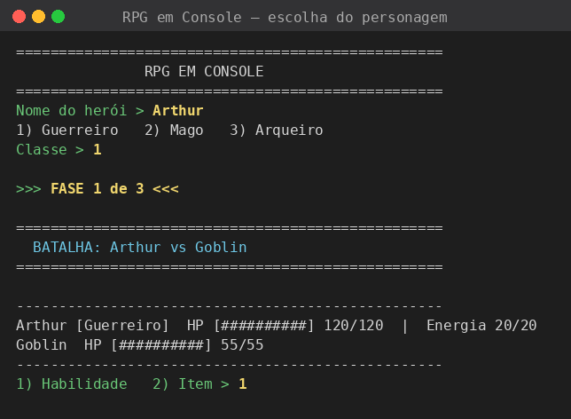
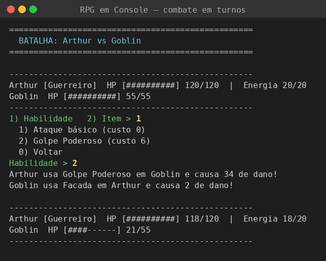
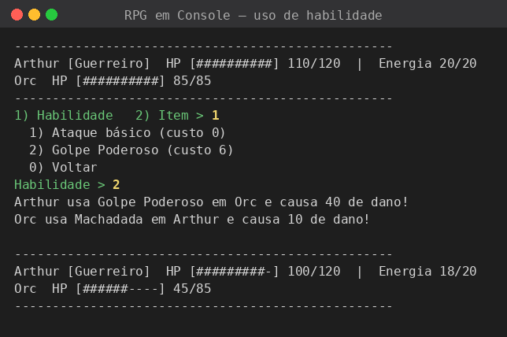
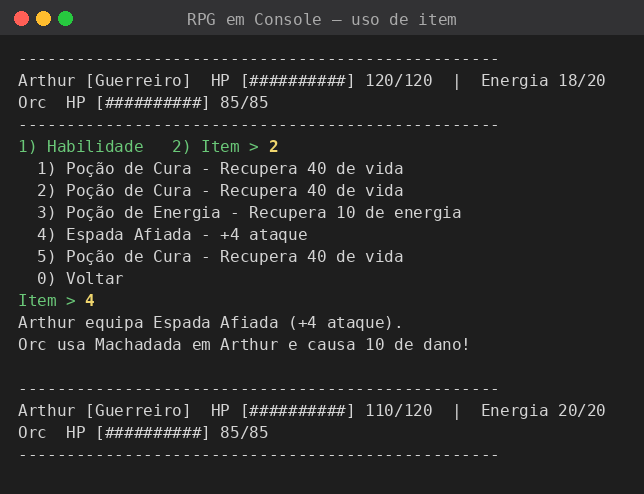
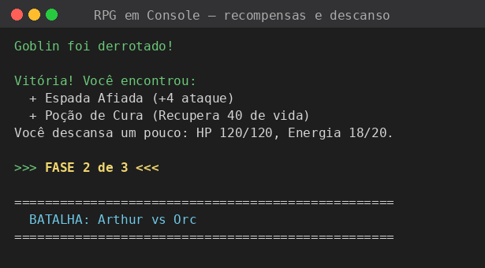
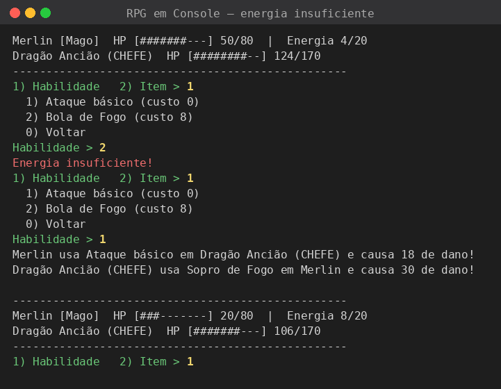
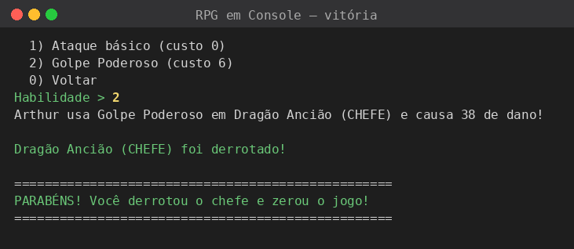
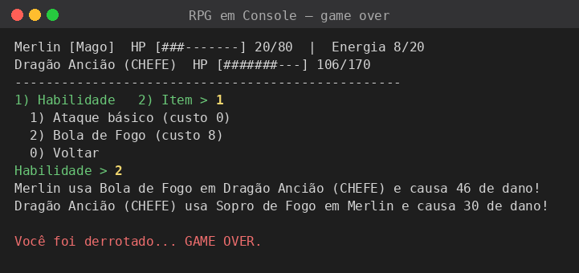
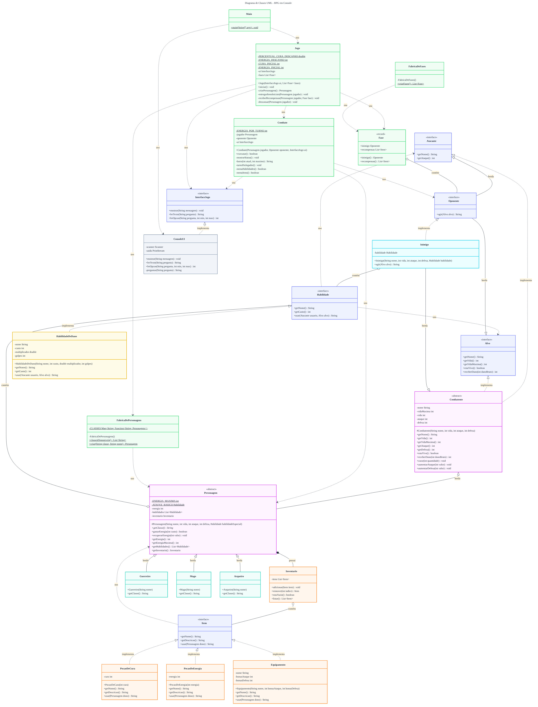

# RPG em Console (POO & SOLID)

Jogo de RPG por turnos em modo console, desenvolvido em **Java** para a disciplina de **Paradigmas de Programação**. O objetivo do projeto é aplicar Programação Orientada a Objetos (abstração, encapsulamento, herança e polimorfismo) e os 5 princípios **SOLID**.

**Autor:** SEU NOME COMPLETO

---

## Sumário

1. [Funcionalidades](#funcionalidades)
2. [Como compilar e executar](#como-compilar-e-executar)
3. [Como jogar](#como-jogar)
4. [Capturas de tela](#capturas-de-tela)
5. [Diagrama de classes](#diagrama-de-classes)
6. [Princípios SOLID aplicados](#princípios-solid-aplicados)
7. [Conceitos de POO aplicados](#conceitos-de-poo-aplicados)
8. [Estrutura do projeto](#estrutura-do-projeto)

---

## Funcionalidades

- **3 classes de personagem:** Guerreiro, Mago e Arqueiro, com atributos de Vida, Ataque e Defesa e uma habilidade especial cada.
- **Combate em turnos** contra 3 inimigos em sequência: Goblin, Orc e Dragão Ancião (chefe).
- **Sistema de energia:** habilidades especiais gastam energia, que se recupera a cada turno.
- **Inventário e itens:** Poção de Cura, Poção de Energia e Equipamentos (aumentam ataque ou defesa).
- **Recompensas e descanso** entre as batalhas.
- **Interface de console** com menus numerados e validação de todas as entradas.

---

## Como compilar e executar

### Requisitos

- **JDK 17 ou superior** (desenvolvido e testado com Java 21). Confira com `java -version` e `javac -version`.

### 1. Baixar o projeto

```bash
git clone https://github.com/SEU_USUARIO/rpg-console.git
cd rpg-console
```

### 2. Compilar e executar

**Linux / macOS:**

```bash
mkdir -p out
javac -encoding UTF-8 -d out $(find src -name "*.java")
java -cp out rpg.Main
```

Ou, com o script pronto: `./executar.sh`

**Windows (CMD):**

```bat
chcp 65001
mkdir out
dir /s /b src\*.java > fontes.txt
javac -encoding UTF-8 -d out @fontes.txt
java -cp out rpg.Main
```

Ou, com o script pronto: `executar.bat`

> O comando `chcp 65001` ajusta o CMD para UTF-8, necessário para os acentos aparecerem corretamente.

**Windows (PowerShell):**

```powershell
mkdir out
javac -encoding UTF-8 -d out (Get-ChildItem -Recurse -Filter *.java src).FullName
java -cp out rpg.Main
```

### Executando pela IDE (IntelliJ IDEA)

1. Abra a pasta do projeto (**File → Open**).
2. Abra `src/rpg/Main.java`.
3. Clique no triângulo verde ao lado de `public static void main` e escolha **Run 'Main.main()'**.
4. Jogue pelo painel **Run**, na parte inferior da IDE.

---

## Como jogar

1. Digite o nome do herói e escolha a classe (1, 2 ou 3).
2. A cada turno, escolha **1) Habilidade** ou **2) Item**. A opção **0) Voltar** cancela a escolha sem gastar o turno.
3. O ataque básico é grátis. As habilidades especiais gastam energia.
4. Depois da sua ação, o inimigo ataca e você recupera 4 de energia.
5. Vença os 3 inimigos para zerar o jogo. Se a vida do herói chegar a zero, é *Game Over*.

**Regra do dano:** `dano = ataque x multiplicador - defesa do alvo`, com mínimo de 1 por golpe.

| Classe | Vida | Ataque | Defesa | Habilidade especial | Custo |
|---|---|---|---|---|---|
| Guerreiro | 120 | 18 | 8 | Golpe Poderoso (2,0x) | 6 |
| Mago | 80 | 24 | 3 | Bola de Fogo (2,2x) | 8 |
| Arqueiro | 95 | 17 | 5 | Tiro Duplo (2 golpes de 1,2x) | 5 |

| Inimigo | Vida | Ataque | Defesa | Golpe | Recompensas |
|---|---|---|---|---|---|
| Goblin | 55 | 10 | 2 | Facada (1,0x) | Espada Afiada (+4 ataque), Poção de Cura |
| Orc | 85 | 15 | 4 | Machadada (1,2x) | Armadura de Couro (+3 defesa), Poção de Cura, Poção de Energia |
| Dragão Ancião (chefe) | 170 | 21 | 6 | Sopro de Fogo (1,6x) | (fim do jogo) |

O herói começa com 2 Poções de Cura (+40 de vida) e 1 Poção de Energia (+10). Após cada vitória, descansa e recupera 20% da vida máxima e 6 de energia.

---

## Capturas de tela

### Escolha do personagem


### Combate em turnos


### Uso de habilidade especial


### Uso de item


### Recompensas e descanso


### Validação: energia insuficiente


### Vitória


### Game Over


---


### Versão no estilo Mermaid

Mesmo diagrama, em Mermaid: caixas coloridas por tipo (interfaces, classes abstratas, heróis, inimigo, itens, habilidades, orquestração e interface de console) e setas com rótulos (*herda*, *implementa*, *possui*, *contém*, *usa*).



### Código-fonte do diagrama

O diagrama está disponível como código, em três formatos (todos com as mesmas classes, atributos e métodos):

| Arquivo | Formato | Como usar |
|---|---|---|
| `docs/diagrama-classes.mmd` | Mermaid (com cores e rótulos) | Colar em [mermaid.live](https://mermaid.live) para ver e exportar. |
| `docs/diagrama-classes.puml` | PlantUML | Colar em [plantuml.com/plantuml](https://www.plantuml.com/plantuml) para ver e exportar. |
| `docs/diagrama-classes.dot` | Graphviz | `dot -Tpng docs/diagrama-classes.dot -o docs/img/diagrama-classes.png` |

---

## Princípios SOLID aplicados

### S: Single Responsibility Principle (Responsabilidade Única)

*Cada classe deve ter apenas um motivo para mudar.*

| Classe | Única responsabilidade |
|---|---|
| `Combate` | Controlar o fluxo dos turnos de uma batalha. Não calcula dano, não lê teclado. |
| `ConsoleUI` | Entrada e saída de texto no console. Não conhece regra de jogo. |
| `Inventario` | Guardar e gerenciar a lista de itens. |
| `Combatente` | Atributos de combate e regras de dano e cura. |
| `Jogo` | Conduzir a partida: criar o herói, percorrer as fases, recompensas. |
| `FabricaDePersonagens` | Criar heróis. |
| `FabricaDeFases` | Montar a campanha (inimigos e recompensas). |
| `Main` | Montar as peças e iniciar o jogo. |

Exemplo prático: para mudar o texto exibido, mexo só em `ConsoleUI`. Para mudar a ordem dos turnos, só em `Combate`. Para ajustar a dificuldade, só em `FabricaDeFases`.

### O: Open/Closed Principle (Aberto para extensão, fechado para modificação)

*Dá para adicionar comportamento novo sem editar o código que já existe.*

- **Itens:** o jogo tem três implementações da interface `Item` (`PocaoDeCura`, `PocaoDeEnergia` e `Equipamento`). `PocaoDeEnergia` foi acrescentada sem alterar `Inventario`, `Combate` nem `Personagem`.
- **Habilidades:** `Combate` apenas chama `habilidade.usar(...)`. Uma habilidade nova é uma nova classe que implementa `Habilidade`.
- **Heróis:** um novo `Ladino` é uma subclasse de `Personagem` mais **uma linha** em `FabricaDePersonagens` (`CLASSES.put("Ladino", Ladino::new)`). O menu de escolha em `Jogo` é montado a partir da fábrica e se atualiza sozinho.
- **Fases:** `Jogo` percorre uma `List<Fase>`. Uma fase nova é um item a mais na lista, sem tocar em `Jogo`.

### L: Liskov Substitution Principle (Substituição de Liskov)

*Uma subclasse deve poder substituir a classe pai sem quebrar o programa.*

- `Guerreiro`, `Mago` e `Arqueiro` herdam de `Personagem`. `Combate` e `Jogo` trabalham com `Personagem` e funcionam com qualquer um dos três, **sem usar `instanceof`** e sem tratar casos especiais.
- As subclasses só informam seus atributos, sua habilidade especial e `getClasse()`. Não alteram nem enfraquecem o comportamento herdado de `Combatente` (`receberDano`, `curar`).
- `Personagem` e `Inimigo` são ambos `Combatente`, e as habilidades os tratam igualmente como `Atacante` e `Alvo`.
- Qualquer `Item`, `Habilidade` ou `Oponente` pode ser usado onde a interface é esperada.

### I: Interface Segregation Principle (Segregação de Interfaces)

*Nenhuma classe deve ser obrigada a implementar métodos que não usa.*

As interfaces são pequenas e cada uma tem um papel:

| Interface | Papel |
|---|---|
| `Atacante` | Só o necessário para atacar (`getNome`, `getAtaque`). |
| `Alvo` | Só o necessário para receber dano. |
| `Oponente` | Um adversário que sabe agir (`agir`). |
| `Habilidade` | Uma ação especial. |
| `Item` | Algo que pode ser usado. |
| `InterfaceJogo` | Somente entrada e saída (3 métodos). |

`Inimigo` implementa apenas `Atacante`, `Alvo` e `Oponente`, sem ser obrigado a ter energia, inventário ou lista de habilidades, que só fazem sentido para o `Personagem`. Uma `Habilidade` enxerga só um `Atacante` e um `Alvo`, e não o personagem inteiro.

### D: Dependency Inversion Principle (Inversão de Dependência)

*Classes de alto nível devem depender de abstrações, não de detalhes concretos.*

- **`Combate` → `InterfaceJogo` e `Oponente`:** recebidos pelo construtor. `Combate` nunca usa `Scanner` nem `System.out`, e não conhece a classe `Inimigo`.
- **`Jogo` → `InterfaceJogo`:** a interface e a lista de fases são injetadas pelo construtor.
- **`Inimigo` → `Habilidade`:** a habilidade é entregue pronta pelo construtor (via `FabricaDeFases`). O inimigo não cria uma `HabilidadeDeDano` por conta própria.
- **`Personagem` → `Habilidade`:** a habilidade especial é recebida pelo construtor, vinda da subclasse.
- **`Inventario` → `Item`:** guarda a abstração, nunca `PocaoDeCura` ou `Equipamento`.
- **`Main` como raiz de composição:** é o único lugar que escolhe as implementações concretas (`new ConsoleUI()`) e as conecta ao `Jogo`.

### Limitação conhecida

`Combate` usa a classe abstrata `Personagem` (e não uma interface) para o herói, pois precisa de energia, habilidades e inventário, que são exclusivos do herói. `Personagem` é uma abstração, mas não uma interface pura. Para o escopo deste trabalho considerei esta uma decisão adequada.

---

## Conceitos de POO aplicados

| Conceito | Onde aparece |
|---|---|
| **Abstração** | Classes abstratas `Combatente` e `Personagem`; interfaces `Atacante`, `Alvo`, `Oponente`, `Habilidade`, `Item` e `InterfaceJogo`. |
| **Encapsulamento** | Todos os atributos são `private`. O estado só muda por métodos como `receberDano()`, `curar()` e `gastarEnergia()`. Listas expostas como somente leitura (`Collections.unmodifiableList`). Construtores validam os valores. |
| **Herança** | `Personagem` e `Inimigo` estendem `Combatente`; `Guerreiro`, `Mago` e `Arqueiro` estendem `Personagem`. |
| **Polimorfismo** | `Combate` chama `habilidade.usar(...)`, `item.usar(...)` e `oponente.agir(...)` sem saber a classe concreta. Cada uma responde à sua maneira. |
| **Composição** | `Personagem` possui um `Inventario` e `Habilidade`s; `Inimigo` possui uma `Habilidade`; `Fase` possui um `Oponente` e `Item`s. |

---

## Estrutura do projeto

```
rpg-console/
├── src/
│   └── rpg/
│       ├── Main.java
│       ├── Jogo.java
│       ├── Fase.java
│       ├── FabricaDeFases.java
│       ├── combate/
│       │   ├── Alvo.java
│       │   ├── Atacante.java
│       │   ├── Oponente.java
│       │   └── Combate.java
│       ├── habilidades/
│       │   ├── Habilidade.java
│       │   └── HabilidadeDeDano.java
│       ├── itens/
│       │   ├── Item.java
│       │   ├── PocaoDeCura.java
│       │   ├── PocaoDeEnergia.java
│       │   ├── Equipamento.java
│       │   └── Inventario.java
│       ├── personagens/
│       │   ├── Combatente.java
│       │   ├── Personagem.java
│       │   ├── Guerreiro.java
│       │   ├── Mago.java
│       │   ├── Arqueiro.java
│       │   ├── Inimigo.java
│       │   └── FabricaDePersonagens.java
│       └── ui/
│           ├── InterfaceJogo.java
│           └── ConsoleUI.java
├── docs/
│   ├── diagrama-classes.mmd      (código Mermaid)
│   ├── diagrama-classes.puml     (código PlantUML)
│   ├── diagrama-classes.dot      (código Graphviz)
│   └── img/            (diagrama e capturas de tela)
├── executar.sh
├── executar.bat
├── .gitignore
└── README.md
```
